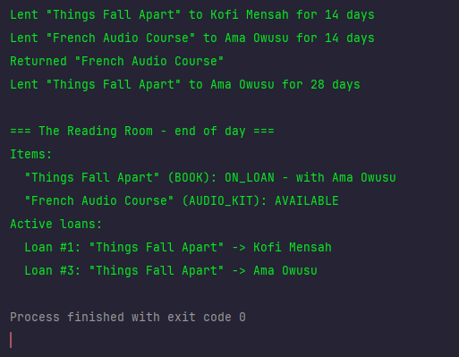

# Diagnosis: The Reading Room Lending Tracker

## Executive Summary
The existing monolithic `LendingTracker` script has served its purpose as a quick prototype, but it has accumulated critical architectural defects. Because all state is public, tightly coupled via fragile string matching, and lacks fundamental validation checks, the system is brittle and prone to data corruption. The most dangerous flaw; allowing an item to be checked out while already on loan, directly threatens the library's physical inventory and volunteer trust.

---

## Detailed Defects & Business Risks
### 1. [CRITICAL] The Double-Loan Problem
* **What is wrong:** The `borrow()` method blindly updates an item's status to `ON_LOAN` and assigns a new borrower, regardless of its current state. As seen in the image, Ama can successfully borrow "Things Fall Apart" while Kofi still has it.
  
* **Root cause:** Complete absence of a pre-condition check (`if (item.isAvailable())`) inside the `borrow` logic.
* **Business Risk:** This is the most dangerous defect for the library. It creates "phantom" inventory conflicts where two members believe they are legally entitled to the same book, leading to lost items, frustrated patrons, and inventory shrinkage that volunteers cannot reconcile.

### 2. [HIGH] Fragile Stringly-Typed Architecture & Title-Based Matching
* **What is wrong:** Item types (`"BOOK"`, `"AUDIO_KIT"`), member kinds (`"STANDARD"`, `"STUDENT"`), and loan statuses are represented as raw Strings. Furthermore, loans link items to members using text titles (`l.itemTitle.equals(item.title)`) rather than unique object references or IDs.
* **Root cause:** Lack of domain modeling using Enums and object memory references.
* **Business Risk:** Typos (e.g., `"BOOK "` or `"Standard"`) cause silent logic failures. More critically, if the library ever acquires two copies of a book with the same title, returning one will prematurely close active loans for both.

### 3. [MEDIUM] Public Mutable State & Lack of Encapsulation
* **What is wrong:** All fields across `LendingItem`, `Member`, and `Loan` are `public`. Any part of the program (or future experimental code) can directly reassign `item.status = "AVAILABLE"` or `loan.status = "ACTIVE"` without going through business rules.
* **Root cause:** Procedural programming style written inside a single-file script without object-oriented access modifiers or encapsulation principles.
* **Business Risk:** Total loss of data integrity. A volunteer or buggy script can corrupt item statuses, misalign loan histories, or invalidate records accidentally, making the tool terrifying to touch ("don't touch the code").

### 4. [LOW] Monolithic Tight Coupling & Non-Extensibility
* **What is wrong:** All loan duration rules (`14 days for books, 7 for audio kits, doubled for students`) are hardcoded inside massive `if-else` blocks inside the `Library` class.
* **Root cause:** Business logic is embedded directly inside operational methods rather than encapsulated within domain objects or polymorphic strategies.
* **Business Risk:** While not immediately breaking current inventory, adding upcoming features like e-loans would require cluttering the core `borrow` method with more nested conditionals, increasing the likelihood of breaking existing book/audio returns.
---

## Proposed Architecture Sketch
````mermaid
stateDiagram-v2
    direction TB

    [*] --> NewRequest

    state "New Borrow Request" as NewRequest
    state "Validate Request" as Validation
    state "Check Book Availability" as CheckAvailability
    state "Book Available" as Available
    state "Book Not Available" as NotAvailable
    state "Validate Member" as MemberValidation
    state "Create Loan Record" as CreateLoan
    state "On Loan" as OnLoan
    state "Exception Handler" as Exception
    state "Display Error Message" as Error
    state "Return Request" as Return
    state "Update Loan Record" as UpdateLoan
    state "Book Available Again" as AvailableAgain

    NewRequest --> Validation: Volunteer submits request

    Validation --> CheckAvailability: Request is valid
    Validation --> Exception: Invalid request

    CheckAvailability --> Available: Book is available
    CheckAvailability --> NotAvailable: Book already on loan

    NotAvailable --> Exception: Block checkout

    Exception --> Error: Raise clear exception
    Error --> [*]: Cancel request

    Available --> MemberValidation: Check member eligibility

    MemberValidation --> CreateLoan: Member is valid
    MemberValidation --> Exception: Member is invalid

    CreateLoan --> OnLoan: Save loan and update book status

    OnLoan --> Return: Member returns book

    Return --> UpdateLoan: Validate return

    UpdateLoan --> AvailableAgain: Close loan and update book status

    AvailableAgain --> [*]: Lending process completed
    OnLoan --> [*]: Loan remains active
````

## State Transitions Explained

| State | Description |
|---|---|
| New Borrow Request | Volunteer initiates a request to borrow a book for a registered member. |
| Validate Request | System checks that the book and member details are valid and complete. |
| Check Book Availability | System checks whether the requested book is currently available or already on loan. |
| Book Available | Requested book is available and can proceed to member eligibility validation. |
| Book Not Available | Book is already on loan and cannot be borrowed again. |
| Validate Member | System confirms that the member is registered and eligible to borrow. |
| Create Loan Record | System creates a new loan record linking the book and member using their unique IDs. |
| On Loan | Book is successfully checked out, and its status changes to `ON_LOAN`. |
| Exception Handler | System blocks invalid operations and handles exceptions without corrupting existing records. |
| Display Error Message | Volunteer receives a clear, understandable explanation of why the borrowing request was rejected. |
| Return Request | Member returns the borrowed book to the library. |
| Update Loan Record | System closes the active loan and updates the loan history. |
| Book Available Again | Book status changes back to `AVAILABLE` and it can be borrowed again. |


